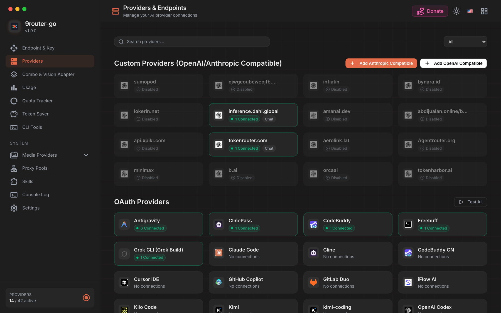
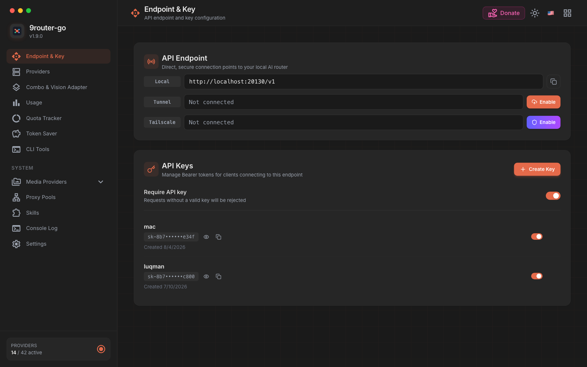

<div align="center">

# PanRouter-Go — FREE AI Router & Token Saver (Single Binary)

> **Built on the shoulders of two MIT projects.**
> The router itself is **[9router](https://github.com/decolua/9router)** by
> **decolua and contributors**. The Go port this repository started from is
> **[9router-go](https://github.com/luqman-v1/9router-go)** by
> **Luqmanul Hakim**. Both copyright notices stay in `LICENSE`.
>
> This repository is the Go port of **[PanRouter](https://github.com/jhopan/PanRouter)**,
> which is where the behaviour is decided. Ports follow PanRouter; they do not
> diverge from it.

**Never stop coding. Save 20-40% tokens with RTK + auto-fallback to FREE & cheap AI models.**

**Connect Claude Code, Cursor, Antigravity, Codex, Gemini, OpenCode, Cline, OpenClaw... to 40+ AI providers & 100+ models — no Node.js needed at runtime.**

[](https://github.com/jhopan/PanRouter-Go/actions/workflows/ci.yml)
[](https://github.com/jhopan/PanRouter-Go/actions/workflows/release.yml)
[](https://github.com/jhopan/PanRouter-Go/releases/latest)
[](https://github.com/jhopan/PanRouter-Go/blob/main/LICENSE)
[](https://github.com/jhopan/PanRouter-Go/releases)
[](https://jhopan.github.io/PanRouter-Go/tg)

[🚀 Quick Start](#-quick-start) • [💡 Features](#-key-features) • [⚙️ Setup](#-setup-guide) • [🔄 Share DB with PanRouter](#-sharing-a-database-with-panrouter) • [🌐 Upstream](https://github.com/decolua/9router)

</div>

---

## 🤔 Why panrouter-go?

Same idea as [PanRouter](https://github.com/decolua/9router), minus the Node.js runtime: **one Go binary** serves the proxy APIs + an embedded Svelte dashboard.

**Stop wasting money, tokens and hitting limits:**

- ❌ Subscription quota expires unused every month
- ❌ Rate limits stop you mid-coding
- ❌ Tool outputs (git diff, grep, ls...) burn tokens fast
- ❌ Manual switching between providers

**panrouter-go solves this:**

- ✅ **RTK Token Saver** — auto-compress tool_result content, save 20-40% tokens
- ✅ **Auto fallback** — Subscription → Cheap → Free, zero downtime
- ✅ **Extended combo routing** — per-combo strategy: fallback, round-robin, sticky, capacity, or fusion
- ✅ **Multi-account** — round-robin between accounts per provider
- ✅ **Proxy per API key** — bind a proxy pool to each provider API key (connection), one-by-one or via **Apply Proxy** across many at once
- ✅ **Custom headers** — add your own request headers to custom compatible providers
- ✅ **Unified custom provider add** — one shared dialog adds OpenAI-/Anthropic-compatible endpoints
- ✅ **Custom usage ranges** — analyze any window (`14d`, `12h`), not just fixed presets
- ✅ **Extended logging** — live console log with level filters & search, plus per-request payload inspector
- ✅ **Single binary** — Go + embedded dashboard, works with Claude Code, Codex, Cursor, Cline, any CLI tool

---

## 🔄 How It Works

```text
┌─────────────┐
│  Your CLI   │  (Claude Code, Codex, OpenClaw, Cursor, Cline...)
│   Tool      │
└──────┬──────┘
       │ http://localhost:20130/v1
       ↓
┌─────────────────────────────────────────────┐
│         panrouter-go (Smart Router)           │
│  • RTK Token Saver (cut tool_result tokens) │
│  • Format translation (OpenAI ↔ Claude)     │
│  • Quota tracking                           │
│  • Auto token refresh                       │
└──────┬──────────────────────────────────────┘
       │
       ├─→ [Tier 1: SUBSCRIPTION] Claude Code, Codex, GitHub Copilot
       │   ↓ quota exhausted
       ├─→ [Tier 2: CHEAP] GLM ($0.6/1M), MiniMax ($0.2/1M)
       │   ↓ budget limit
       └─→ [Tier 3: FREE] Kiro, OpenCode Free, Vertex ($300 credits)

Result: Never stop coding, minimal cost + 20-40% token savings via RTK
```

---

## ⚡ Quick Start

**1. Install (one line):**

```bash
# macOS / Linux
curl -fsSL https://raw.githubusercontent.com/luqman-v1/panrouter-go/main/install.sh | bash
```

```powershell
# Windows (PowerShell — installer writes to %LOCALAPPDATA% + user PATH, no admin needed)
irm https://raw.githubusercontent.com/luqman-v1/panrouter-go/main/install.ps1 | iex
```

🎉 Then start it (defaults: port `20130`, data `~/.panrouter` — no flags needed):

```bash
panrouter-go
# Dashboard: http://localhost:20130 (Default password: 123456)
```
> **Already using upstream [PanRouter](https://github.com/decolua/9router)?** Point panrouter-go at the same data dir — it opens the **same `DATA_DIR/db/data.sqlite`**. Your providers, connections, combos, API keys, and usage history carry over as-is. No import step, no migration. See [Sharing a database with PanRouter](#-sharing-a-database-with-panrouter) for the caveats.

**Keep the terminal free (background mode):**

```bash
panrouter-go start          # same as: panrouter-go --background   (or -d)
panrouter-go status         # is it running? (pid, dashboard, log)
panrouter-go restart        # replace the running daemon
panrouter-go logs -n 100    # tail the background log
panrouter-go stop           # stop it
```

The detached process records itself in `DATA_DIR/run/gateway.pid` and writes its
output to `DATA_DIR/run/gateway.log`. A second `start` while one is running
refuses instead of fighting over the port, and a daemon killed from Task Manager
leaves nothing behind: the stale pid file is cleaned on the next command.
> Windows stops the process with `TerminateProcess` instead of `SIGTERM`, so
> stopping skips the graceful drain; use the dashboard's Shutdown button or
> `panrouter-go restart` when you want in-flight streams to finish first.

**Start on boot (autostart):**

```bash
panrouter-go service install     # systemd user unit, launchd agent, OpenRC/runit service, cron @reboot, or a Windows logon task
panrouter-go service status      # which backend owns the entry, and whether it is enabled/active
panrouter-go service start       # start the supervised service now (falls back to the background daemon)
panrouter-go service restart     # restart it
panrouter-go service stop        # stop it now but keep it enabled for boot
panrouter-go service uninstall   # remove the autostart entry
```

`install` picks the native backend for the host. systemd, launchd, and cron all
install into the **user** scope and need no root; runit's `~/service` path too.
Two exceptions: OpenRC is a system service and needs root (`service install`
refuses without it — run with `sudo`, or pick `--backend cron`), and on Windows
install registers a scheduled task via `schtasks`, which requires an
Administrator console. The Windows task runs as the current user at logon, so it
reads that user's data dir rather than `SYSTEM`'s. Force a backend with
`--backend systemd|launchd|openrc|runit|cron`.

**2. Connect a FREE provider (no signup needed):**

Dashboard → Providers → Connect **Kiro AI** (~50 credits/month free) or **OpenCode Free** (no auth) → Done!

**3. Use in your CLI tool:**

```text
Claude Code / Codex / OpenClaw / Cursor / Cline Settings:
  Endpoint: http://localhost:20130/v1
  API Key:  [Settings → API Keys in the dashboard]
  Model:    kr/claude-sonnet-4.5
```

**That's it!** Start coding with FREE AI models.

**Alternatives:**

```bash
# Docker — no build needed
docker run -d --name panrouter-go --restart unless-stopped \
  -p 20130:20130 -v "$HOME/.panrouter:/data" \
  -e PORT=20130 -e DATA_DIR=/data \
  -e INITIAL_PASSWORD=your-secure-password \
  luqmenul/panrouter-go:latest

# Manual download — pick your file, no command line guesswork:
# Windows → .exe | Mac M1+ → darwin-arm64 | Mac Intel → darwin-amd64
# Linux VPS → linux-amd64 | Raspberry Pi → linux-arm64
```

📦 [All release binaries](https://github.com/jhopan/PanRouter-Go/releases/latest) • 🔨 [Build from source](#-setup-guide)

---

## 💡 Key Features

- 🖥️ Native Svelte 5 dashboard: providers, OAuth, combos, proxy pools, API keys, usage, quota, settings, plans, per-entry sidebar visibility
- 💱 Cost display in USD, IDR, EUR and ten more currencies — editable rate table, dual display, one-click refresh from a public provider
- 🔌 OpenAI Chat, Claude Messages, Gemini, Ollama-compatible, Responses, embeddings, media, search, web tools
- 🔁 Combos with fallback, round-robin, sticky routing, fusion, capability-aware reordering
- 👥 Per-provider executors, OAuth refresh, reactive 401 retry
- 📡 Live usage + console-log SSE streams, stall detection
- 💾 SQLite WAL persistence, outbound proxy support, self-update, MITM commands, Docker, cross-compilation

For sequential combo routing, set **Model response timeout** in seconds (decimals
such as `5.3` are fine) in the combo's Edit dialog, or from the compact field on the
combo card. Empty or `0` disables it. The timer covers each model
candidate except the last, including connection selection and waiting for a
usable response. If it expires before output is committed, the router cancels
that candidate and tries the next. The last candidate keeps the gateway's
normal deadline, so the setting never makes a combo fail sooner than it would
without it (#744). An active stream is not cut off by this setting. For
non-streaming requests, the timer covers the wait for the complete response.
Fusion panel timing is separate. A model that times out is left out of that
combo for a
grace period (default 5 minutes, set per combo under the timeout in the Edit
dialog; `0` re-includes it on the next request) and then rejoins the chain. If
every model in the chain is inside its grace period, the full chain is used. The
pause is held in memory and resets on restart. Stored as
`firstTokenGraceMs` next to the timeout. The dashboard shows seconds; the setting is stored in
milliseconds as `comboStrategies[comboName].firstTokenTimeoutMs`.

---

## 🔄 Sharing a database with PanRouter

**Already running [PanRouter](https://github.com/decolua/9router) (the Next.js version)? panrouter-go reads that exact database. There is no import, no export, and no migration step.**

Both projects default to the same file and speak the same schema:

| | Path |
|---|---|
| macOS / Linux | `~/.panrouter/db/data.sqlite` |
| Windows | `%APPDATA%\panrouter\db\data.sqlite` |
| Docker | `/data/db/data.sqlite` inside the container |

Stop PanRouter, start panrouter-go, and log in with your existing password. Your provider connections, proxy pools, combos, API keys, model aliases, and usage history are all there — panrouter-go's own dashboard renders them, because it *is* the same data.

**You don't even have to stop PanRouter** if you want to keep the Node.js dashboard around. Run panrouter-go on a different port against the same `DATA_DIR`:

```bash
# PanRouter on :20128 (Next.js)  ·  panrouter-go on :20130 (Go, same DB)
PORT=20130 DATA_DIR=/home/you/.panrouter ./panrouter-go
```

Both read the same tables, so a connection you add in either dashboard shows up in the other. SQLite serialises the writes; the supported setup is one active writer, so avoid editing the same combo or settings entry in both at the same moment.

**Running it the other way round** (panrouter-go first, then pointing PanRouter at the same directory) works the same way. panrouter-go will have added two columns to `providerConnections` (`lastUsedAt`, `consecutiveUseCount`) and one extra table (`upstream_leases`). Upstream ignores both — its schema sync is additive and doesn't drop unknown columns — so nothing breaks.

What panrouter-go will **not** do:

- **Import a legacy JSON export.** If your PanRouter data still lives in old JSON files, start upstream once to convert them, then switch.
- **Run destructive migrations or pre-migration backups.** Its bootstrap only ever *adds* — create missing tables, add missing columns, seed missing rows. It never drops or retypes.
- **Interpret `_meta.schemaVersion`.** It's upstream's migration bookkeeping. A database written by a much newer PanRouter release should be checked before you rely on it.

Take a backup first if the database matters:

```bash
cp -r ~/.panrouter/db ~/panrouter-db-backup   # stop the daemon first — see DATABASE.md
```

Full schema, operator contract, and multi-process limits: [`DATABASE.md`](DATABASE.md). Routing internals: [`ARCHITECTURE.md`](ARCHITECTURE.md).

---

## 📸 Screenshots





---

## ⚙️ Setup Guide

### Release binary

Download from [GitHub Releases](https://github.com/jhopan/PanRouter-Go/releases/latest), verify against `SHA256SUMS.txt`.

### 🧪 Experimental builds

Unreleased work also ships as **experimental** builds. They are published
separately and are never offered to a normal install:

- GitHub Releases marks them **Pre-release**, so `releases/latest` — the URL
  `panrouter-go update` falls back to — keeps pointing at the stable version.
- Docker Hub tags them `exp` (`luqmenul/panrouter-go:exp`), never `latest`.

```bash
docker pull luqmenul/panrouter-go:exp
```

Opt in only if you want to help shake out bugs. `panrouter-go update` will not
install one over a stable release — grab the asset for your platform from the
[pre-releases page](https://github.com/jhopan/PanRouter-Go/releases) and
replace the running binary with it.

### Build from source

Prerequisites: Go 1.27 and Bun 1.x (dashboard is embedded into the binary, so build web first):

```bash
git clone https://github.com/jhopan/PanRouter-Go.git
cd panrouter-go
make web-build   # bun install --frozen-lockfile && bun run build
make build       # embeds VERSION into the Go binary
```

### Run

Defaults are enough for most people — plain `panrouter-go` listens on port `20130` with data in `~/.panrouter`:

```bash
panrouter-go
curl http://localhost:20130/health
./panrouter-go version
```

Only override when you need something different (`PORT`, `DATA_DIR`/`DB_PATH` — there are no `--port` flags):

```bash
PORT=20129 ./panrouter-go                        # different port
DATA_DIR=/srv/panrouter ./panrouter-go              # different data dir
DB_PATH=/srv/panrouter/data.sqlite ./panrouter-go   # explicit SQLite file
HOST=127.0.0.1 ./panrouter-go                     # localhost only, behind a reverse proxy
```

### 🔑 Dashboard Login & Fresh Install

- **Localhost (`localhost` / `127.0.0.1`)**: First login uses the default compatibility password `123456`. Once logged in, change your password in **Settings → Profile**.
- **Remote / VPS / Docker / LAN**: For security (preventing public takeover of fresh installs with known defaults, CVE-2026-56679), remote access blocks the default `123456` password. You **must** either:
  1. **Set `INITIAL_PASSWORD` on launch (Recommended)**:
     ```bash
     INITIAL_PASSWORD="your-secure-password" ./panrouter-go
     # Or in your .env file:
     # INITIAL_PASSWORD=your-secure-password
     ```
  2. **Or access via SSH port-forwarding first**:
     ```bash
     ssh -L 20130:127.0.0.1:20130 user@remote-host
     # Open http://localhost:20130, login with 123456, then change password in Settings
     ```

### Client example

```bash
curl http://localhost:20130/v1/chat/completions \
  -H 'Content-Type: application/json' \
  -H 'Authorization: Bearer sk-your-api-key' \
  -d '{"model":"ag/gemini-3.8-flash-high","messages":[{"role":"user","content":"Hello"}],"stream":true}'
```

For Claude Messages clients: `ANTHROPIC_BASE_URL=http://localhost:20130/v1`.

<details>
<summary><b>Advanced: environment variables, API surface, auth, database</b></summary>

### Environment

| Variable | Default | Purpose |
| --- | --- | --- |
| `PORT` | `20130` | HTTP port |
| `HOST` / `BIND_ADDR` | all interfaces | Listener address |
| `DATA_DIR` | `~/.panrouter` (`%APPDATA%/panrouter` on Windows) | Data root |
| `DB_PATH` | `$DATA_DIR/db/data.sqlite` | SQLite file |
| `INITIAL_PASSWORD` | unset (fallback `123456` locally) | First dashboard password |
| `RTK_ENABLED` | `true` | RTK input compression |
| `CAVEMAN_ENABLED` / `PONYTAIL_ENABLED` | `false` | Style savers |
| `AUTO_UPDATE` | `false` | Background self-update |
| `HTTP_PROXY` / `HTTPS_PROXY` | Go defaults | Upstream egress proxy |
| `PPROF_ENABLED` | `false` | Expose `/debug/pprof/*` (keep off on untrusted networks) |
| `TRUST_PROXY` / `TRUST_CLOUDFLARE` | unset | Trust forwarded client-IP headers |
| `TRUSTED_PROXIES` | unset | CIDR list of the reverse proxies whose forwarded client-IP headers are trusted |
| `GEMINI_WEB_ROTATION` | `on` | Renew the Gemini Web session cookie in the background (see below) |

#### Gemini Web session renewal

The `gemini-web` provider reaches `gemini.google.com` with a session cookie,
and Google rotates the session's timestamp cookie (`__Secure-1PSIDTS`) every
few minutes. The router renews it in the background, so a signed-in account
keeps reaching the models it pays for instead of falling back to one model
after a few minutes.

**There are three ways to get a session, and the dashboard offers two of
them as a button.**

1. *A throwaway browser* — the safest. The button opens a browser with a
   profile of its own, waits for the Google sign-in, reads the session out of
   it, then closes the browser and deletes the profile. Nothing is left
   running that could rotate the session, so the router's renewal is the
   only one.
2. *A browser that is already signed in* — the convenient one. The button
   opens the browser's own cookie database, takes the key that seals it from
   the platform's secret store (the login keyring on Linux, the Keychain on
   macOS, the profile's "Local State" file on Windows), and unseals the
   cookies. **A browser that is still open keeps rotating the same session**
   and the router renews it from the other side, and the two cancel each
   out — which signs the account out. Close the browser first, or use the
   throwaway browser above. The dashboard says so when it finds a browser
   that is running.
3. *A cookie you paste* — the fallback. Copy the cookie header from an
   Incognito window that you close right after, not from a normal tab, and
   paste it into the connection form.

Set `GEMINI_WEB_ROTATION=off` to run the router without renewing anything at
all. That is the right choice when the credential belongs to a browser you
want to keep using.

`.env.example` documents the security-sensitive subset and OAuth overrides.

A forwarded client-IP header is only read when the TCP peer is inside the
trusted set — otherwise a client could rotate `X-Forwarded-For` and give every
login attempt its own rate-limit bucket. `TRUST_PROXY=true` trusts loopback and
the RFC1918/link-local ranges; `TRUSTED_PROXIES` takes a comma-separated list
of CIDRs or single IPs and **replaces** those defaults, so set it when the
proxy connects from an address outside them.

Behind a proxy that is *not* in the trusted set, every request is bucketed by
the proxy's own socket address, so all users of that proxy share one login
bucket: five failed attempts lock them all out. `TRUSTED_PROXIES` is the knob
that separates them again.

### API surface

```text
POST /v1/chat/completions       OpenAI Chat Completions
POST /v1/messages               Claude Messages
POST /v1/responses              Responses API
POST /v1/embeddings             Embeddings
POST /api/chat                  Ollama-compatible chat
GET  /v1/models                 Model catalog
POST /v1/images/generations     Image generation
POST /v1/videos/generations     Video generation
POST /v1/audio/speech           Text to speech
POST /v1/audio/transcriptions   Speech to text
POST /v1/search                 Web search
GET  /api/usage/stream          Live usage SSE
GET  /health                    Liveness
GET  /api/version               Version metadata
```

### Authentication

- Public: `/health`, dashboard HTML/assets, `/login`, OAuth callbacks.
- Proxy routes need an active client API key (`Authorization: Bearer` / `X-API-Key`).
- Dashboard APIs need a session cookie, CLI token, or API key; destructive ops (shutdown, update, DB import) need a session or CLI token.
- The API server defaults to all interfaces — bind localhost or protect the port outside trusted machines.

### Database compatibility

Go reads/writes the upstream panrouter table/JSON shapes and bootstraps the core schema on startup (creates the 11 tables when absent, backfills missing columns, seeds an empty settings row) — a fresh `DATA_DIR` just works, no upstream install needed. Existing databases are never modified beyond additive backfills. Full contract in [`DATABASE.md`](DATABASE.md), routing internals in [`ARCHITECTURE.md`](ARCHITECTURE.md).

</details>

---

## 🤝 Contributing

Issues and pull requests use templates, so pick the right one rather than opening a blank report:

- **Bug report** — something behaves incorrectly. Include a reproduction, `panrouter-go version`, OS, and the log excerpt around the failure.
- **Feature request** — the problem you cannot solve today, the surface it touches, and whether upstream already has it.
- **Upstream parity** — a behaviour `decolua/panrouter` has and this gateway does not; link the upstream commit or PR.
- **Question** — configuration and usage help.

PRs follow the checks CI runs: `go vet ./...`, `go test -count=1 ./...`, `make test-integration`, plus `cd web && bun test` and `make vet-svelte` for anything touching the dashboard. Before writing code, skim [`AGENTS.md`](AGENTS.md) — provider isolation and the Go/Svelte conventions there are enforced by review.


## 📚 Docs

- [`ARCHITECTURE.md`](ARCHITECTURE.md) — routing, providers, runtime layout
- [`DATABASE.md`](DATABASE.md) — SQLite schema & operator contract
- [`ROADMAP.md`](ROADMAP.md) — proposals only, not current behavior
- [`CHANGELOG.md`](CHANGELOG.md) — release history (Go **v1.9.9**, upstream baseline `decolua/panrouter` v0.5.85). Work merged since the last tag lives in [`.changes/`](.changes/) and is folded in at the next release; the dashboard's changelog modal shows both.
- [`docs/TELEGRAM_RELEASE_NOTIFICATIONS.md`](docs/TELEGRAM_RELEASE_NOTIFICATIONS.md) — one-time setup for the release notice posted to Telegram

## Credits

- [PanRouter](https://github.com/decolua/9router) — original Next.js gateway & dashboard this Go port preserves compatibility with

## 📄 License

MIT License — lihat [`LICENSE`](https://github.com/jhopan/PanRouter-Go/blob/main/LICENSE).
