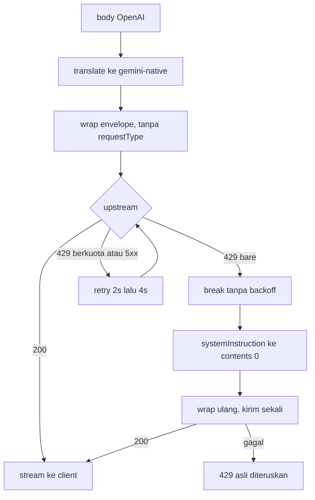

# Informasi Perbaikan Gemini (lane Antigravity)

Dokumen ini menjelaskan kenapa request ke `ag/gemini-3.8-flash-high` (dan model
lain di lane `antigravity`) pernah dijawab `429 RESOURCE_EXHAUSTED` padahal kuota
masih ada, dan apa yang sudah diperbaiki. Tulisannya sengaja faktual: setiap
angka di sini datang dari pengukuran, bukan dugaan.

Terakhir diperbarui: 2026-11-21.

---

## 1. Gejala

Tiga gejala berbeda muncul berurutan, masing-masing menutupi penyebab berikutnya.
Kalau salah satu muncul lagi, lompat ke bagian yang cocok.

| Gejala | Arti |
|---|---|
| `429` + `"Resource has been exhausted (e.g. check quota)."` **tanpa detail** | Google menolak **bentuk** request, bukan kuota |
| `429` yang sama tapi tidak ada baris `systemInstruction moved into contents[0]` di log | fallback tidak jalan (lihat §4) |
| `499` (`client canceled request`) setelah `wait=2s` lalu `wait=4s` | caller menyerah sebelum fallback kebagian giliran (lihat §5) |

Pembeda penting: 429 kuota **asli** selalu membawa detail.

```
429 asli   : "Individual quota reached... Resets in 151h18m21s."  + QUOTA_EXHAUSTED + quotaResetDelay
429 palsu  : "Resource has been exhausted (e.g. check quota)."     + tidak ada apa pun
```

Dashboard model test (`POST /api/models/test`, 1 MSG, tanpa tool) menjawab **200**
untuk akun dan model yang sama. Itu bukan bukti kuota sehat — test itu tidak
mengirim system prompt klien, jadi tidak ada yang bisa ditolak.

---

## 2. Penyebab

Pemicunya adalah **bentuk `systemInstruction` itu sendiri**, bukan isinya yang
spesifik. Terbukti dengan menangkap payload asli (148.553 byte, `systemInstruction`
92.943 karakter, 34 tool) lalu menembakkannya **langsung ke backend**, gateway di
luar gambar:

| payload | hasil |
|---|---|
| envelope tertangkap, 148 KB | 429 |
| sama, `tools` dihapus | 429 |
| `systemInstruction` dipotong ke 51 KB | 200 |
| **`systemInstruction` dipindah ke `contents[0]`** | **200** |

Menghapus tool tidak menolong, jadi bukan tool. Memindahkan instruksi ke turn user
menyembuhkan, jadi itu obatnya.

---

## 3. Yang dilakukan gateway sekarang

Urutan untuk satu request di lane antigravity:



Empat keputusan:

| Komponen | Perilaku |
|---|---|
| `wrapForAntigravity` | `requestType` **tidak** dikirim; Google membucket nilainya ke kuota kecil terpisah |
| `antigravityBareQuotaRefusal` | 429 dianggap "bare" bila memuat `resource_exhausted` dan **tidak** memuat `quota_exhausted`, `rate_limit_exceeded`, `individual quota reached`, `retryinfo`, atau `reset` |
| retry loop | bare → serahkan langsung, **tanpa** menunggu |
| `MoveSystemInstructionToContents` | teks system pindah ke turn user pertama, member `systemInstruction` dihapus, field lain dipertahankan byte-per-byte |

Setelah relokasi, envelope **tetap** punya `systemInstruction` — isinya blok
identitas lane (`<identity>...Antigravity...`). Itu benar: lane selalu butuh blok
itu. Yang hilang adalah teks pemanggil, dan teks itu sekarang ada di `contents[0]`.

### Baris log yang perlu dicari

```text
systemInstruction moved into contents[0] cleared the refusal      -> berhasil, 200
systemInstruction relocation did not clear the refusal            -> dicoba, tidak menolong
antigravity transient fault, retrying the same call               -> retry in-place (bukan bare)
```

Kalau 429 muncul dan **tidak ada** salah satu baris relokasi, fallback tidak
sampai dijalankan — lihat §4 dan §5.

---

## 4. Kenapa fallback-nya pernah mati (jangan ulangi)

`ForwardGemini` membangun body dengan:

```go
geminiBody, err := translator.TranslateOpenAIToGeminiWithSession(...)
```

Tanda `:=` di dalam blok `else` membuat **variabel lokal baru** yang membayangi
variabel tingkat fungsi. Variabel luar tetap `nil`, sehingga fallback memanggil
`MoveSystemInstructionToContents(nil)` → `false` → tidak ada log, tidak ada retry.
Fallback terkirim sebagai kode mati. Perbaikannya: tugaskan ke variabel fungsi,
jangan bayangi.

Pelajaran yang berlaku umum di repo ini: **fallback tanpa test adalah kode yang
belum terbukti ada.** Sekarang ada `TestForwardGemini_MovesSystemInstructionToClearABareRefusal`
yang mengunci tiga hal: retry benar-benar dikirim, teks pemanggil tidak lagi di
`systemInstruction`, dan teks itu tiba di turn pertama.

---

## 5. Kenapa sempat jadi 499

429 bare tidak akan sembuh dengan mengulang byte yang sama. Loop lama tetap
menunggu 2s + 4s = 6 detik, sementara caller menyerah di 5,6 detik:

```text
retrying wait=2s attempt=1
retrying wait=4s attempt=2
fallback client canceled request
status=499 duration=5.6s
```

Sekarang bare 429 langsung diserahkan ke relokasi. Hasil ukur: **6,09s → 0,08s**
di test, dan 5,5s lewat gateway untuk persona 95 KB.

---

## 6. Hipotesis yang sudah diuji dan ditolak

Jangan ulangi ini; semuanya menjawab **200**:

- jumlah tool: 13, 20, 24, 28, 31, 34, 35
- panjang deskripsi tool sampai ~26 KB skema
- `reasoning_effort` medium/high, `parallel_tool_calls`, `tool_choice`
- `content` sebagai string vs array blok
- tanpa role `system` sama sekali (2 user message)
- baris identitas Hermes berdiri sendiri
- frasa `prompt injection`, `MUST use your tools`, `[OUT-OF-BAND USER MESSAGE]`
- IP pengirim: rumah vs VPS
- urutan request (rate limit) — diuji dengan urutan dibalik, batasnya tetap sama

Baris netralisasi fingerprint Hermes di `internal/translator/antigravity.go` tetap
berguna untuk kasus prompt 100 KB (probe 429 → 200), tetapi untuk kegagalan dengan
persona 90 KB, obatnya adalah relokasi, bukan netralisasi.

---

## 7. Tool calling: jalan

Diuji dua putaran lewat gateway pada `antigravity/gemini-3.8-flash-high`:

```text
turn 1: finish_reason=tool_calls, 1 call, name=get_weather
turn 2: finish_reason=stop, "The current weather in Bandung is rainy with a temperature of 24°C."
        memakai hasil tool = true
```

Catatan untuk pemanggil:

- `tool_call.id` bersifat **opaque** dan berisi sufiks privat `__ts__<thoughtSignature>`.
  Echo kembali apa adanya; gateway membuang sufiks itu sebelum ke wire. Jangan
  membuat ID sendiri, dan jangan memotongnya.
- Hasil tool dikirim sebagai pesan `role: "tool"` dengan `tool_call_id` yang sama.
- Jumlah tool yang banyak (34–35) aman; itu bukan pemicu 429.

---

## 8. Biaya dan risiko

- **Setiap request yang ditolak membayar dua panggilan upstream**: satu ditolak,
  satu dilayani. Selama persona tetap ~90 KB, itu biaya permanen.
- Latensi hasil ukur 5,5s untuk persona 95 KB — mepet dengan timeout caller 5,6s
  yang sempat membatalkan request. Kalau `499` muncul lagi sesekali, naikkan
  timeout di client, bukan di gateway; gateway sudah tidak menunggu tanpa alasan.
- **Model Claude di lane ini belum diuji** dengan persona besar
  (`claude-sonnet-4-6`, `claude-opus-4-6-thinking`). Lane-nya sama, perilakunya
  bisa berbeda.

---

## 9. Cara memverifikasi ulang

```bash
# test yang mengunci fallback (harus lulus < 1s)
go test ./internal/proxy/ -run MovesSystemInstruction -v

# paket yang tersentuh
go test ./internal/proxy/ ./internal/translator/ ./internal/handlers/chat/

# seluruh suite
go test ./...
go vet ./...
```

Untuk menguji jalur nyata: arahkan client ke gateway lokal, kirim satu request
yang membawa system prompt besar, lalu cari baris relokasi di log.
